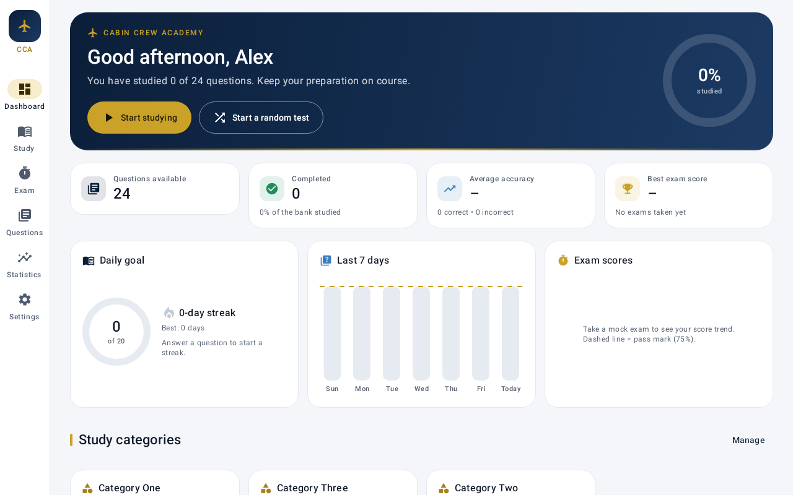
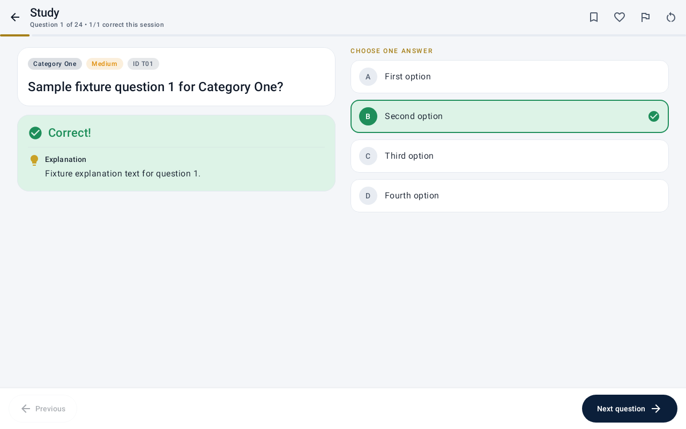
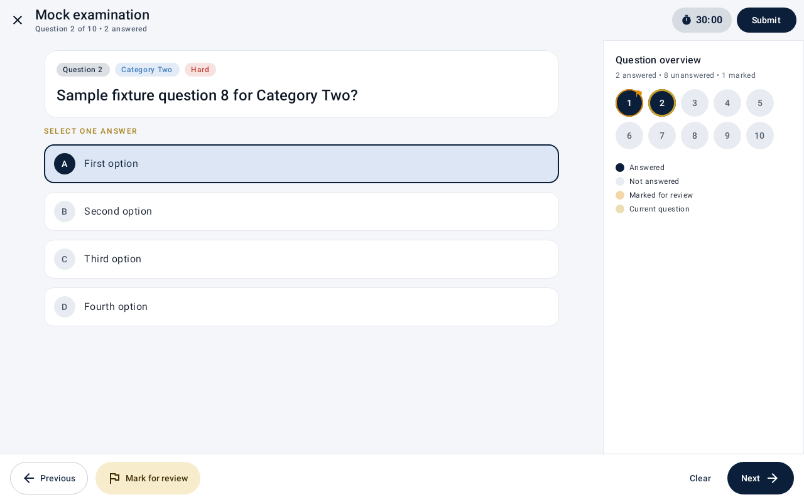
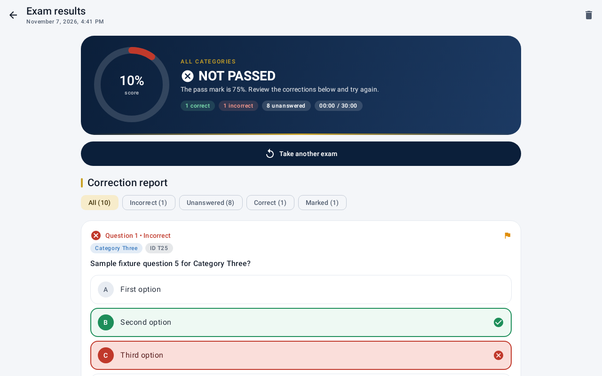
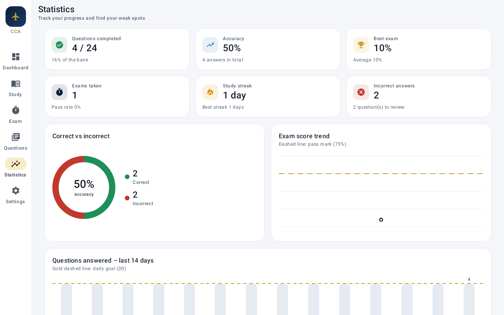
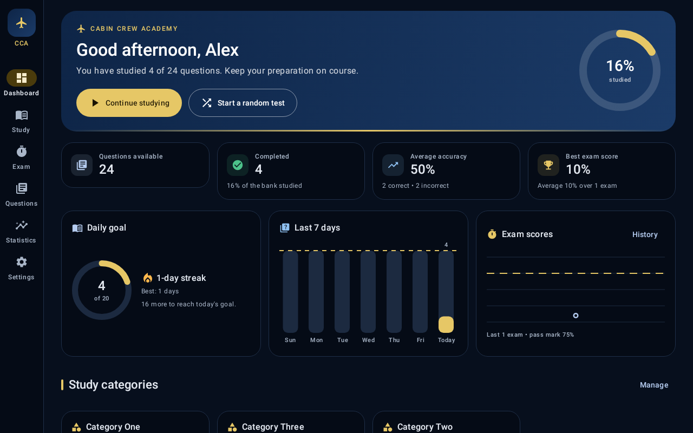

# Cabin Crew Academy ✈️

A native Android study and exam-simulation app for people preparing for **cabin crew recruitment tests and assessments**. It's built for Android tablets in landscape and portrait, and it also runs on phones.

- **100% offline.** There's no account, no registration, no subscription and no internet permission.
- **Your content.** The app ships with an empty question bank. You import your own questions and answers from JSON or CSV files, or you type them in.
- **Everything stays on your device.** Questions, progress, statistics and settings are kept in a local database.

| Dashboard (tablet, landscape) | Study mode with instant feedback |
|---|---|
|  |  |
| **Exam simulator** | **Correction report** |
|  |  |
| **Statistics** | **Dark mode** |
|  |  |

> The screenshots use neutral placeholder test questions. They come from the automated UI tests, not from real study content.

---

## 1. Install the app on your tablet

1. Copy **`release/CabinCrewAcademy-v1.0.0.apk`** to the tablet. You can use a USB cable, Google Drive, e-mail or a memory card.
2. On the tablet, open the APK file with the **Files** app.
3. If Android asks, allow **"Install unknown apps"** for the app you used to open the APK (Settings → Apps → Special access → Install unknown apps).
4. Tap **Install** and then **Open**.

The app needs Android 8.0 (API 26) or newer.

**Updating:** install a newer APK over the old one. As long as the new build is signed with the same key (see *Signing key* below), your questions and progress are kept. **Do not uninstall first**, because uninstalling deletes the app's data.

---

## 2. Load your questions

On first launch the dashboard shows **Import questions**. The full format reference is in [`docs/IMPORT_GUIDE.md`](docs/IMPORT_GUIDE.md). Here is the short version:

```json
{
  "categories": [
    {
      "name": "Aviation Knowledge",
      "questions": [
        {
          "id": "Q001",
          "question": "Example question?",
          "options": ["Option A", "Option B", "Option C", "Option D"],
          "correctAnswer": 1,
          "explanation": "Explanation of the correct answer."
        }
      ]
    }
  ]
}
```

- `correctAnswer` is the **zero-based index** of the correct option. `0` means the first option and `1` means the second.
- CSV is supported too. Use one row per question; Excel's comma or semicolon formats both work.
- You can select **several files at once** for a bulk import.
- Every file is **validated before anything is saved**. Errors are listed with the file name and the row or path where they occur.
- Questions whose `id` already exists are **never overwritten unless you confirm it**.
- Empty templates are in [`docs/templates/`](docs/templates). You can also save them from inside the app (Questions → Import / Export → *Save JSON template*).

---

## 3. Features

| Area | What you can do |
|---|---|
| **Dashboard** | Personal greeting, total and completed questions, study-progress ring, average accuracy, best and average exam score, daily-goal ring, study streak, 7-day activity chart, exam-score trend, category cards with progress, recent activity, *Continue studying* (resumes exactly where you left off) and *Start a random test* |
| **Study mode** | One question at a time, select → *Check answer* → correct/incorrect feedback, correct answer highlighted, explanation shown, previous/next/skip, bookmark, favourite, mark as difficult, restart session, end-of-session summary, *Review my incorrect* |
| **Study filters** | All questions, not yet studied, **incorrect answers only**, bookmarked, favourites, marked difficult; by category; by difficulty; shuffled order; *Random practice* |
| **Exam simulator** | Random questions from the bank, configurable number of questions, countdown timer (or no limit) with auto-submit, question navigator, mark for review, clear answer, submit confirmation that warns about unanswered or marked questions, configurable pass mark |
| **Results** | Score %, PASSED / NOT PASSED, correct/incorrect/unanswered counts, time taken, and a full correction report (filter by incorrect / unanswered / correct / marked) that shows your answer, the correct answer and the explanation |
| **Question bank** | Keyword search (question, options, explanation, ID), filter by category, difficulty, bookmarked, favourites, difficult, answered incorrectly or not studied; create, edit and delete questions |
| **Categories** | Create, rename (with description) and delete; one-tap *suggested categories* (names only) |
| **Statistics** | Questions completed, accuracy, correct-vs-incorrect ring, exam trend with pass-mark line, 14-day activity, **performance by category sorted weakest first**, revision lists, full exam history |
| **Settings** | Light / dark / system theme, your name, exam duration, questions per test, passing score, daily goal, import/export, reset progress, delete all questions, about |

---

## 4. Build from source

Requirements: JDK 17+ and the Android SDK (platform 35, build-tools 35). You can use Android Studio Ladybug or newer, or the command line:

```bash
cd CabinCrewAcademy
echo "sdk.dir=/path/to/Android/sdk" > local.properties   # Android Studio does this for you
./gradlew assembleRelease          # → app/build/outputs/apk/release/app-release.apk
./gradlew assembleDebug            # debug build (installs side-by-side as "com.cabincrew.academy.debug")
./gradlew testDebugUnitTest        # unit tests + Robolectric UI tour (writes screenshots to app/build/screenshots)
```

To open the project in Android Studio, choose *File → Open* and select the `CabinCrewAcademy` folder.

### Technology

Kotlin 2.0 · Jetpack Compose · Material 3 · Room · DataStore · Navigation Compose · Coroutines and Flow · MVVM. Charts are drawn with Compose `Canvas`, so the app has no third-party chart dependency.

### Project structure

```
app/src/main/java/com/cabincrew/academy/
├── data/
│   ├── db/              Room entities, DAOs, database, type converters
│   ├── importexport/    JSON/CSV parser + validator, exporter, templates
│   ├── repository/      StudyRepository – single source of truth for all data operations
│   └── settings/        DataStore-backed app settings
├── domain/              Study session configuration, streak calculation
└── ui/
    ├── components/      Design system: cards, hero banner, option cards, charts
    ├── theme/           Navy / white / gold palette, typography, shapes (light + dark)
    ├── dashboard/  study/  exam/  questions/  categories/  importexport/  stats/  settings/
    └── CabinCrewApp.kt  Adaptive shell (navigation rail on tablets, bottom bar on phones) + NavHost
```

See [`docs/MAINTENANCE.md`](docs/MAINTENANCE.md) for how to maintain the question database, back up and restore data, and change the app safely.

### Signing key

Release builds are signed with the key named in `keystore.properties`. That file is git-ignored, and so is the `keystore/` folder; see `keystore.properties.example`. Without it, release builds fall back to the local debug key.

**Keep your signing key safe and private.** Android only installs an update over an existing app when both are signed with the same key. If you lose the key, a new build can only be installed after uninstalling the old app, which deletes its progress. Export your questions first if that happens.
